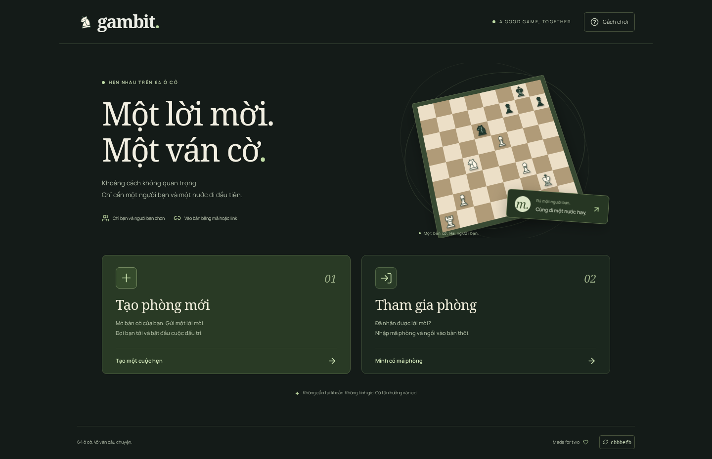

# Gambit — Hẹn nhau một ván cờ.

Tạo phòng, chia sẻ mã/link và chơi cờ với một người bạn trên thiết bị khác. **[Mở game trên GitHub Pages](https://mowfteedev.github.io/chess/)**. Chỉ chơi giữa người với người, không có đối thủ máy.



## Chơi cùng nhau

1. Chọn **Tạo phòng mới**, nhập tên, chọn màu quân và **1, 5 hoặc 10 phút mỗi bên** (mặc định 5 phút).
2. Gửi mã 6 ký tự hoặc link mời. Người thứ hai mở link hoặc chọn **Tham gia phòng**.
3. Mỗi người chỉ đi quân của mình. Quân phản hồi ngay trên máy người đi; máy chủ xác minh trước khi gửi cho đối thủ. Nước bị từ chối được trả về trạng thái đã xác nhận.
4. Đồng hồ bắt đầu khi đủ hai người, không cộng giây sau mỗi nước. Hết giờ được máy chủ xác nhận. Đấu lại cần đồng ý, đổi màu và đặt lại cùng thời lượng.

Có chọn quân bằng chạm/nhấn, kéo thả, bàn phím, nhập thành, bắt tốt qua đường, phong cấp, chiếu bí/hòa, đầu hàng và tải PGN. Thông báo cho biết ai vào/rời/trở lại bàn; âm thanh cho nước đi, bắt quân, chiếu, lượt của bạn và kết thúc ván, có nút tắt/bật.

**Ván tính giờ vẫn chạy khi mất kết nối.** Người còn kết nối có thể đi đúng lượt của mình. Phòng cũ không tính giờ vẫn giữ cách tạm dừng trước đây. Phiên ẩn danh được giữ theo tab để hỗ trợ reload; đóng tab hoặc xóa phiên có thể mất quyền vào lại ghế. Phòng nhận thao tác trong 48 giờ từ lúc tạo; dữ liệu hết hạn chưa được tự động xóa.

## Hosting và kết nối

- **GitHub Pages:** giao diện React/Vite, font và quân SVG.
- **Supabase:** Anonymous Auth, PostgreSQL, Realtime và Edge Function `chess-rooms`.
- Nước đi qua HTTPS/WebSocket tới máy chủ; không dùng PeerJS, WebRTC, STUN hoặc TURN.
- Postgres khóa hàng khi ghép ghế, dùng revision và ID yêu cầu để chặn thao tác trùng/xung đột. Máy chủ kiểm tra luật chess.js; trình duyệt không có quyền ghi trực tiếp trạng thái.
- Realtime gửi cập nhật nhanh; đọc lại định kỳ hỗ trợ khi WebSocket gián đoạn.

Xem [kiến trúc và contract](docs/ARCHITECTURE.md). Khóa publishable dùng ở trình duyệt; quyền quản trị chỉ nằm trong môi trường Supabase/CLI, không được đưa vào frontend.

## Điện thoại

Bàn cờ dùng gần hết chiều rộng; tiện ích có vùng chạm ≥44px. Màu bàn và biên bản mở trong hộp thoại. Input cỡ 16px, cho phép zoom, hỗ trợ safe area dưới và reduced motion.

[Ảnh sảnh mobile](docs/screenshots/lobby-mobile.png) · [Ván mobile](docs/screenshots/mobile.png) · [Ván desktop](docs/screenshots/game-desktop.png)

## Chạy và kiểm tra

Yêu cầu Node.js 22 trở lên. Docker cần chạy để kiểm thử Supabase cục bộ.

```bash
npm ci
cp .env.example .env.local   # Điền URL và publishable key của project
npm run dev
npm test
npx playwright install chromium
npm run test:e2e
npm run build
npm run preview
```

Bật Anonymous Sign-ins trên project Supabase. E2E tự khởi động stack riêng `gambit-chess-test`, API `127.0.0.1:56321`, áp dụng migration cục bộ và tạo `.env.test.local` được Git bỏ qua. Test dùng PostgreSQL, Auth, Realtime và Edge Runtime thật; các ca nhiều người chặn API WebRTC để xác minh game không cần P2P. Preview test ở `127.0.0.1:4174`.

Sau E2E, chạy `npm run build` để tạo artifact production. GitHub Actions lấy `VITE_SUPABASE_URL`, `VITE_SUPABASE_PUBLISHABLE_KEY` và `VITE_SUPABASE_FUNCTION_REGION` từ repository variables. Region đặt theo database (project hiện tại: `ap-southeast-2`, Sydney) để giảm các lượt đi mạng giữa hàm và database. Không đưa khóa quản trị Supabase vào GitHub Pages.

## Triển khai backend

Sau khi đăng nhập Supabase CLI bằng tài khoản có quyền trên project đích:

```bash
npx supabase db push --linked --project-ref YOUR_PROJECT_REF --dry-run --skip-vault
npx supabase db push --linked --project-ref YOUR_PROJECT_REF --skip-vault
npx supabase functions deploy chess-rooms --project-ref YOUR_PROJECT_REF --use-api
```

Migration là additive và bật RLS. Hàm quản trị chỉ được gọi bởi `service_role`; heartbeat của người chơi chỉ thay đổi trạng thái online của chính họ. Edge Function tự xác thực JWT qua `auth.getUser()` trên mọi POST. `verify_jwt=false` ở gateway là chủ ý để handler xử lý xác thực và mã lỗi nhất quán; POST thiếu JWT hợp lệ vẫn trả 401.

Khi đổi domain frontend, cập nhật danh sách Origin được phép trong Edge Function rồi deploy lại. Cấu hình `supabase/config.toml` chứa thiết lập dành cho test cục bộ; không dùng `supabase config push` để ghi đè cấu hình production.

## Cache

GitHub Pages có thể giữ HTML 10 phút. Mỗi build có `version.json` và mã Git ở cuối trang. Kiểm tra cập nhật dùng `no-store` kèm query riêng; link mời/cập nhật có phiên bản, JS/CSS có tên chứa hash. Không tự reload giữa ván. Entry asset tải thất bại sẽ có nút khôi phục, không để trang trắng. Không cài Service Worker.

Font Manrope phục vụ tại chỗ; giấy phép ở [public/fonts/OFL.txt](public/fonts/OFL.txt). Xem [ghi nhận kiểm thử](docs/QA.md).
